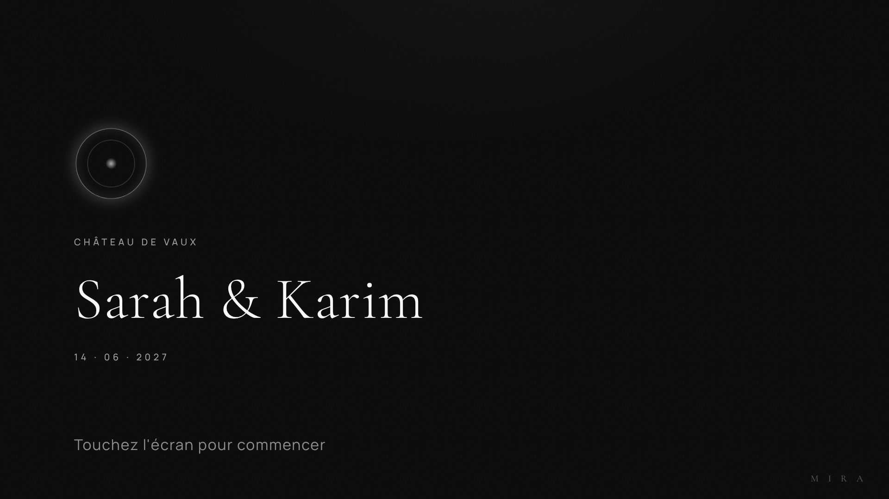
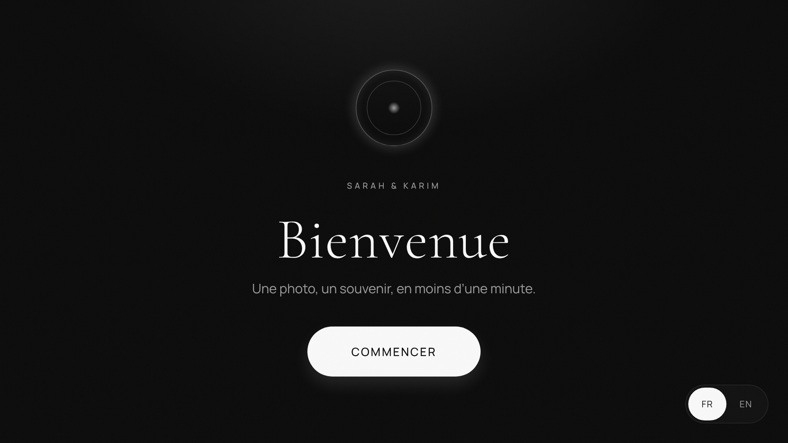
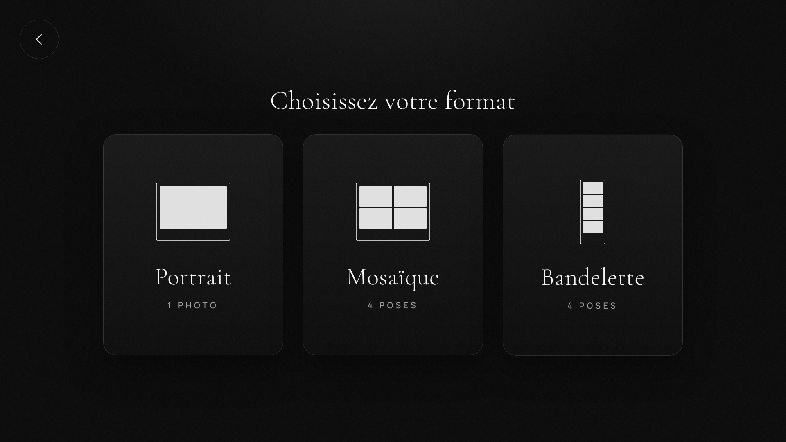
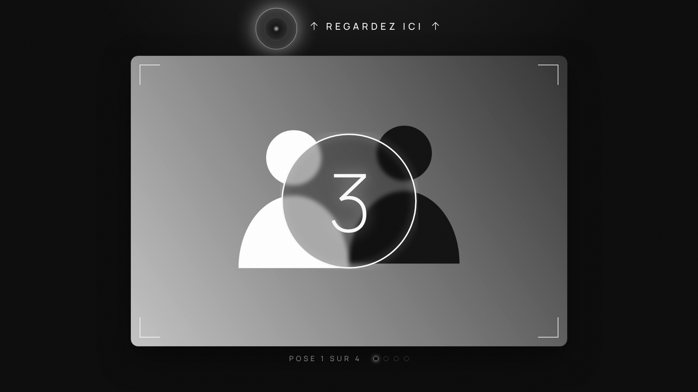
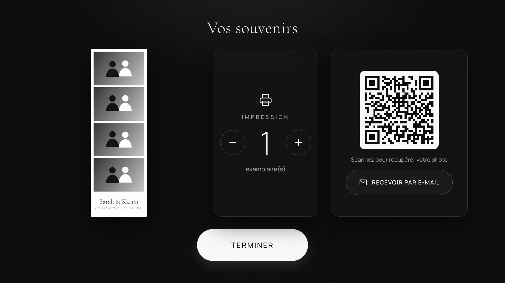
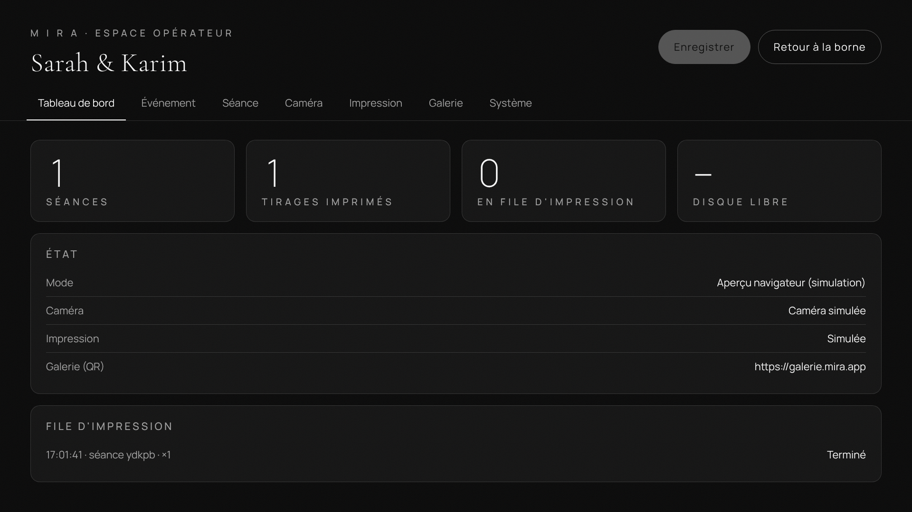

# MIRA BOOTH

Logiciel de borne photo pour écran tactile 15,6" (1920×1080, paysage) : prise de vue,
planches 10×15 pour la DNP DS-RX1HS, QR code, e-mail. Thème noir & blanc. **Aucune IA.**

> **Phase 1 — prototype.** La caméra est une webcam (ou une caméra simulée), l'impression est
> simulée ou passe par le pilote Windows, et les e-mails sont consignés sans être envoyés.
> Le Canon EOS 2000D (EDSDK) et le pilote DNP dédié arrivent en Phase 2.

## Installation (Windows 10/11)

1. Installer [Node.js 22 LTS](https://nodejs.org/).
2. Dans le dossier du projet :
   ```bash
   npm install
   npm run dev        # lance la borne dans une fenêtre (pas en plein écran)
   ```
3. Pour fabriquer l'installateur Windows : `npm run dist:win` (fichier dans `dist/`).

L'application installée démarre en **plein écran verrouillé** (mode kiosque).
Pour forcer le mode fenêtre : variable d'environnement `MIRA_KIOSK=0`.

### Aperçu dans un navigateur (sans Electron)

```bash
npm run dev:web    # puis ouvrir http://localhost:5173
```

Tout le parcours fonctionne ; le stockage, l'impression et la galerie sont simulés en mémoire.

## Utilisation

| Action | Comment |
|---|---|
| Lancer une séance | Toucher l'écran d'attente |
| Espace opérateur | Appui **3 secondes** dans le coin haut-gauche (écran d'attente ou d'accueil), puis code PIN (**1234** par défaut, à changer) |
| Imprimer pour de vrai | Opérateur → Impression → « Imprimante Windows (DNP) » |
| Caler l'impression | Opérateur → Impression → « Imprimer une page de calage », puis ajuster décalage et échelle |
| QR code | Pointe vers `http://<IP de la borne>:8765/s/<événement>/<séance>` : le téléphone doit être sur le même Wi-Fi. Une adresse publique peut être saisie dans Système. |

### Données

Tout est stocké en local dans le dossier de données de l'application
(`%APPDATA%/MIRA BOOTH/mira` sous Windows) :

```
mira/
├─ config.json             réglages
├─ print-queue.json        file d'impression (reprise après redémarrage)
├─ outbox.json             e-mails en attente (Phase 1 : non envoyés)
└─ events/<événement>/<séance>/
   ├─ photo-1.jpg …        photos brutes
   ├─ composite.jpg        image partagée (QR, e-mail)
   ├─ print.jpg            planche 10×15 avec fond perdu
   └─ meta.json            format, consentements, tirages
```

## Parcours invité

Attente → Accueil → Format → Préparation (couleur / noir & blanc) → Compte à rebours
→ Capture (× poses) → Revue (reprise possible) → Livraison (impression, QR, e-mail)
→ Consentement diaporama → Merci → Attente.

Sans activité pendant 45 s (réglable), un « Toujours là ? » s'affiche, puis la borne
revient à l'écran d'attente.

## Formats (papier 10×15)

| Format | Poses | Planche |
|---|---|---|
| Portrait | 1 | 1 photo + légende |
| Mosaïque | 4 | grille 2×2 + légende |
| Bandelettes | 4 | 2 bandes 5×15 identiques, découpe 2" du pilote DNP |

Le rendu se fait à 300 DPI : 1800×1200 utiles, agrandi au format attendu par le pilote
(1844×1240 par défaut, **à vérifier dans le pilote DNP**).

## Développement

```bash
npm run typecheck
npm test
npm run build
```

Structure :

```
src/
├─ main/        processus Electron : fenêtre kiosque, stockage, galerie locale, impression
├─ preload/     pont sécurisé `window.mira`
├─ shared/      types et réglages par défaut
└─ renderer/    interface React
   └─ src/
      ├─ machine/   parcours invité (XState)
      ├─ screens/   un fichier par écran
      ├─ camera/    pilotes caméra (webcam, simulée)
      ├─ render/    modèles et rendu des planches 10×15
      ├─ admin/     espace opérateur
      └─ styles/    design tokens et styles
```

## Prochaines étapes (Phase 2)

- Pilote Canon EOS 2000D (EDSDK) : live view, mise au point pendant le compte à rebours, capture vers le PC.
- Pilote DNP dédié : état papier/ruban, compteur de tirages restants.
- Galerie en ligne, envoi réel des e-mails, synchronisation hors ligne.
- Éditeur de modèles, GIF/Boomerang, mises à jour automatiques.

## Captures

| | |
|---|---|
|  |  |
|  |  |
|  |  |
