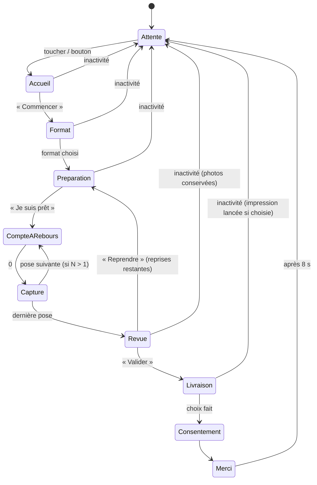

# MIRA BOOTH APP — Phase 1 : plan à valider

> Étape 11.1 du prompt : arborescence, machine à états, écrans, design tokens.
> Rien n'est codé tant que ce plan n'est pas validé.

Cible : écran tactile 15,6" **paysage 1920×1080**, objectif **au-dessus de l'écran**, Windows, i5 / 8 Go.
Règle absolue : **aucune IA**.

---

## 1. Arborescence du projet

```
mira-booth-app/
├─ apps/
│  └─ booth/                    # Application Electron
│     ├─ electron/
│     │  ├─ main.ts             # Fenêtre kiosque, cycle de vie, watchdog
│     │  ├─ preload.ts          # Pont IPC typé (contextIsolation)
│     │  ├─ ipc/                # Handlers : camera, printer, storage, gallery
│     │  └─ services/
│     │     ├─ render.ts        # Composition finale 300 DPI (sharp)
│     │     ├─ storage.ts       # SQLite + fichiers /events/{id}/{session}/
│     │     ├─ printQueue.ts    # File d'impression persistante
│     │     └─ galleryServer.ts # Mini-serveur local (galerie + QR)
│     └─ src/                   # Interface React
│        ├─ app/                # Routing par état XState
│        ├─ screens/            # Un dossier par écran (voir §3)
│        ├─ admin/              # Espace opérateur
│        ├─ machines/           # boothMachine.ts (parcours invité)
│        ├─ i18n/               # fr.json, en.json
│        └─ assets/             # Sons, modèles, polices
├─ packages/
│  ├─ core/                     # Logique sans UI, testée avec Vitest
│  │  ├─ drivers/
│  │  │  ├─ camera/             # CameraDriver + Webcam, Mock, (CanonEdsdk en Phase 2)
│  │  │  └─ printer/            # PrinterDriver + Mock, (DnpRx1 en Phase 2)
│  │  ├─ templates/             # Format des modèles (JSON) + 3 modèles inclus
│  │  └─ config/                # Schéma des réglages (zod) + valeurs par défaut
│  └─ ui/                       # Design system MIRA
│     ├─ tokens.css             # Couleurs, typo, espacements, animations
│     └─ components/            # Button, Card, Keyboard, CountdownRing, Halo, Toast, Modal…
├─ docs/
│  ├─ PROMPT.md
│  └─ PHASE1_PLAN.md
└─ package.json                 # Workspaces pnpm
```

Pile : Electron, React 18, TypeScript, Vite, Tailwind, Framer Motion, XState, Zustand, sharp, better-sqlite3, qrcode, Vitest, Playwright.

---

## 2. Machine à états du parcours invité



Règles :
- **Inactivité** : 45 s par défaut. Un avertissement doux s'affiche 10 s avant (« Toujours là ? »).
- **Erreur caméra** pendant la capture : état `Pause` (« Un instant… ») puis retour automatique. L'opérateur est alerté.
- **Retour** possible depuis Format, Préparation et Livraison.
- Chaque session a un identifiant unique. Ses photos sont enregistrées **avant** l'affichage de la revue.

---

## 3. Écrans (wireframes texte, 1920×1080)

Le **haut de l'écran** est réservé au repère visuel « regardez ici », car l'objectif se trouve juste au-dessus.

### 3.1 Attente
```
┌──────────────────────────────────────────────────────────────┐
│                 (halo doré qui respire, centré haut)          │
│                                                              │
│      Diaporama plein écran des dernières photos (fondu)      │
│                                                              │
│                  M I R A        (logo serif)                 │
│              Touchez l'écran pour commencer                  │
│                    ───── Nom de l'événement ─────            │
└──────────────────────────────────────────────────────────────┘
```

### 3.2 Accueil
Message de bienvenue de l'événement, gros bouton **« Commencer »** (champagne, 120 px de haut), sélecteur de langue discret en bas à droite.

### 3.3 Choix du format
```
┌──────────────────────────────────────────────────────────────┐
│ ←                    Choisissez votre format                 │
│                                                              │
│   ┌──────────┐     ┌──────────┐     ┌──────────┐             │
│   │  ▢       │     │ ▢▢       │     │ ▢ ▢      │             │
│   │          │     │ ▢▢       │     │ ▢ ▢      │             │
│   │  Photo   │     │  Grille  │     │Bandelettes│            │
│   │  unique  │     │ 4 poses  │     │ 4 poses  │             │
│   └──────────┘     └──────────┘     └──────────┘             │
│      Cartes 420×520, aperçu du modèle réel de l'événement    │
└──────────────────────────────────────────────────────────────┘
```

### 3.4 Préparation
Live view en grand (zone 3:2 centrée) avec le cadre du format. Conseil (« Rapprochez-vous ! »), bouton **« Je suis prêt »** et retour.

### 3.5 Compte à rebours + capture
```
┌──────────────────────────────────────────────────────────────┐
│          ▲  Regardez ici  ▲   (halo doré pulsé, en haut)     │
│   ┌──────────────────────────────────────────────────────┐   │
│   │                                                      │   │
│   │        LIVE VIEW         ◯ 3 ◯  (anneau qui se       │   │
│   │                                  referme, chiffre    │   │
│   │                                  serif 220 px)       │   │
│   └──────────────────────────────────────────────────────┘   │
│                        Pose 2 / 4   • • ○ ○                  │
└──────────────────────────────────────────────────────────────┘
```
À 0 : flash blanc doux, son de déclencheur, puis effet « développement » de la photo pendant 1,2 s.

### 3.6 Revue
Composition finale à gauche (grande). À droite : **« C'est parfait »** (principal) et **« Reprendre »** (secondaire, avec le nombre de reprises restantes).

### 3.7 Livraison
```
┌──────────────────────────────────────────────────────────────┐
│ ←                    Vos souvenirs                           │
│  ┌────────────┐   ┌──────────────────┐   ┌──────────────────┐│
│  │  Aperçu    │   │   🖨  Imprimer    │   │  ▣ QR code        ││
│  │  photo     │   │   − 1 +  copies   │   │  (scannez avec    ││
│  │            │   │                   │   │   votre téléphone)││
│  └────────────┘   └──────────────────┘   │  ✉ Recevoir par   ││
│                                          │    e-mail         ││
│                                          └──────────────────┘│
│                          [ Terminer ]                        │
└──────────────────────────────────────────────────────────────┘
```
(Les icônes seront dessinées en SVG fin, pas d'emoji.)

### 3.8 Saisie e-mail
Champ en haut, clavier virtuel MIRA en bas (touches 96 px), suggestions `@gmail.com`, `@hotmail.fr`, `@outlook.fr`, `@yahoo.fr`.

### 3.9 Consentement
Deux choix clairs, rien de pré-coché : « Apparaître dans le diaporama et la galerie de l'événement » et « Recevoir mes photos par e-mail (adresse conservée 30 jours) ». Lien vers la politique de confidentialité via un QR code.

### 3.10 Merci
Signature animée « Merci », rappel « Votre photo s'imprime… » avec une estimation, puis retour à l'attente après 8 s.

### 3.11 Espace opérateur (appui 3 s dans le coin haut-gauche + code PIN)
Onglets : **Tableau de bord** (état caméra, imprimante, disque, compteurs) · **Événement** (nom, textes, formats actifs, modèle, couleurs) · **Caméra** (source, rotation, miroir, recadrage, photo test) · **Impression** (imprimante, copies max, page de test) · **Galerie** (réimprimer, supprimer, exporter ZIP) · **Système** (code PIN, langue, sons, quitter).

---

## 4. Design tokens

```css
:root {
  /* Couleurs */
  --ink: #0E0D12;        /* fond */
  --night: #1A1822;      /* surfaces */
  --night-2: #24212E;    /* surfaces surélevées */
  --champagne: #C9A96E;  /* accent principal */
  --champagne-soft: rgba(201,169,110,.20);
  --ivory: #F5F0E8;      /* texte */
  --ivory-muted: rgba(245,240,232,.62);
  --rose: #E8C4C0;       /* accent secondaire */
  --success: #7FB69E;
  --danger: #D9786F;

  /* Typographie */
  --font-display: "Cormorant Garamond", serif;
  --font-ui: "Manrope", sans-serif;
  --text-body: 24px;  --text-lg: 32px;  --text-h2: 56px;
  --text-h1: 88px;    --text-count: 220px;

  /* Espacements (base 8) */
  --space-1: 8px; --space-2: 16px; --space-3: 24px;
  --space-4: 32px; --space-6: 48px; --space-8: 64px;

  /* Formes */
  --radius-sm: 12px; --radius-md: 20px; --radius-lg: 32px; --radius-pill: 999px;
  --border-glass: 1px solid var(--champagne-soft);
  --blur-glass: 24px;
  --shadow-soft: 0 24px 64px rgba(0,0,0,.45);

  /* Tactile */
  --touch-min: 80px;  --button-primary-h: 120px;

  /* Animations */
  --ease-out-expo: cubic-bezier(.16,1,.3,1);
  --dur-fast: 250ms; --dur-base: 350ms; --dur-slow: 450ms;
}
```

Les couleurs, le logo et le texte d'accueil peuvent être remplacés **par événement**. Un thème « Ivoire » clair est prévu.

---

## 5. Ordre de développement (avec une capture d'écran à chaque étape)

1. Socle : Electron + Vite + React + TS, fenêtre kiosque 1920×1080, design tokens et composants de base.
2. Machine à états XState et navigation entre écrans vides.
3. Écrans Attente, Accueil, Format.
4. Caméra : `WebcamDriver` et `MockCameraDriver`, Préparation, compte à rebours et capture.
5. Rendu des compositions 10×15 (300 DPI) avec 3 modèles, puis écran Revue.
6. Livraison : `MockPrinter`, file d'impression, galerie locale, QR code, e-mail (simulé), clavier virtuel.
7. Consentement, Merci, gestion de l'inactivité et des erreurs.
8. Espace opérateur minimal.
9. Traductions FR/EN, tests (Vitest + Playwright), README.

---

## 6. Points à valider

1. La palette **noir velours + or champagne** te convient-elle, ou préfères-tu un thème clair par défaut (assorti à la borne blanche) ?
2. Les **3 formats** de départ (photo unique, grille 4 poses, bandelettes 4 poses) sont-ils les bons ?
3. Le nombre de reprises par session : **1** par défaut ?
4. Le nombre maximal de copies par session : **2** par défaut ?
